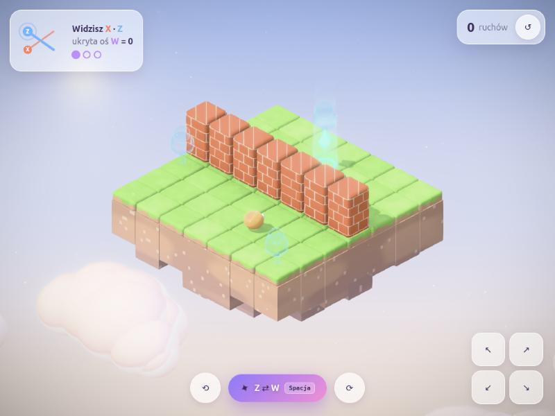
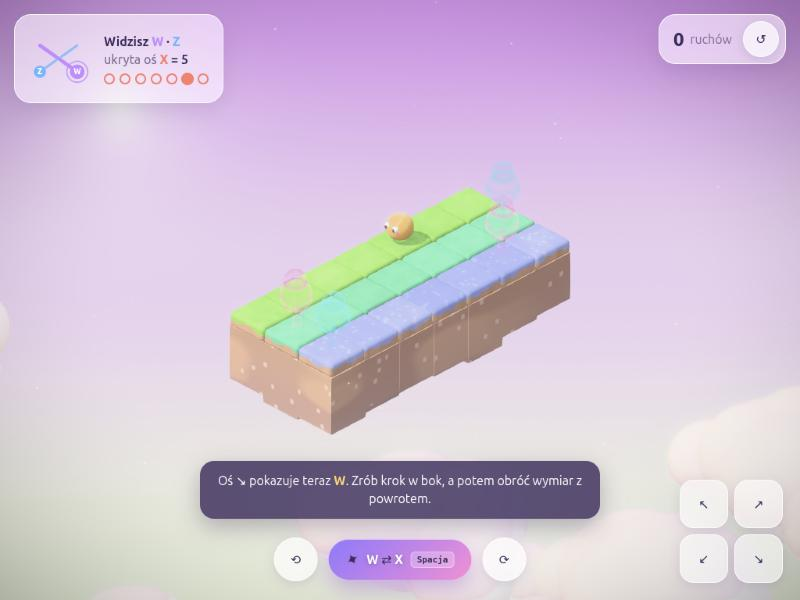
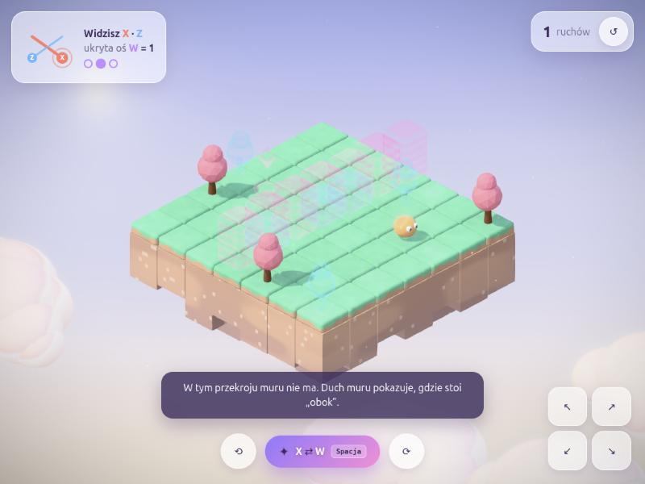

<div align="center">

# ✦ Fourthcoming ✦

**Gra logiczna o czwartym wymiarze. Działa w przeglądarce.**

*Mur nie ma końca, ale tylko w trzech wymiarach.*



</div>

---

## O grze

Fourthcoming to spokojna gra logiczna osadzona w świecie **czterowymiarowym**.
Plansza jest wyspą zawieszoną wśród chmur. Widzisz ją z góry, w rzucie izometrycznym,
ale to tylko trójwymiarowy *przekrój* większego świata. Obok, wzdłuż osi **W**,
leżą kolejne przekroje: podobne, a jednak inne.

Twoja główna zdolność to **obrót wymiaru**. Jedna z widocznych osi zamienia się
miejscami z ukrytą osią W i nagle możesz zrobić krok w kierunku, którego przed chwilą
nie było. Przeszkody nie do pokonania w 3D okazują się zwykłymi przeszkodami,
które da się obejść bokiem.

> **Status:** prototyp / proof of concept. Na razie jest jeden poziom,
> „Nieskończony mur”, który sprawdza, czy mechanika jest czytelna i przyjemna.

## Jak grać

| Klawisz | Przycisk na ekranie | Akcja |
|---|---|---|
| `W` `A` `S` `D` / strzałki | krzyżak ↖ ↗ ↙ ↘ | krok o jedną kratkę |
| `Q` / `E` | ⟲ / ⟳ | obrót planszy o 90° (zmienia tylko kąt patrzenia) |
| `Spacja` | ✦ X ⇄ W | **obrót wymiaru**: oś biegnąca w prawo-dół (↘) zamienia się z ukrytą |
| `R` | ↺ | restart poziomu |

Gizmo w lewym górnym rogu pokazuje, które osie widzisz. Pulsuje oś, którą zamieni
obrót wymiaru. Kropki pod gizmo to przekroje ukrytej osi, a wypełniona kropka to ten,
w którym stoisz.

### Jak czytać czwarty wymiar

- **Duchy.** Półprzezroczyste, holograficzne obiekty to rzeczy z sąsiednich przekrojów.
  **Błękitne** są o jeden krok „w przód” ukrytej osi, **różowe** o jeden krok „w tył”.
- **Kolor trawy** zależy od współrzędnej W. Gdy po obrocie wymiaru widzisz pasy
  w różnych odcieniach, patrzysz właśnie wzdłuż czwartej osi.
- **Obrót wymiaru nigdy nie przesuwa Cię w 4D.** Stoisz dokładnie tam, gdzie stałeś,
  tylko patrzysz na świat „pod innym kątem”. Dwukrotne naciśnięcie wraca do poprzedniego
  widoku.

<table>
<tr>
<td></td>
<td></td>
</tr>
<tr>
<td align="center"><sub>Po obrocie wymiaru: trzy pasy to trzy przekroje W.</sub></td>
<td align="center"><sub>Przekrój bez muru i duch muru z sąsiedniego przekroju.</sub></td>
</tr>
</table>

## Uruchomienie lokalne

Wymagany jest [Node.js](https://nodejs.org/) w wersji 20 lub nowszej.

```bash
npm install
```

```bash
npm run dev
```

Gra będzie dostępna pod adresem <http://localhost:5173>.

| Skrypt | Opis |
|---|---|
| `npm run dev` | serwer deweloperski z hot reloadem |
| `npm test` | testy logiki 4D (Vitest) |
| `npm run build` | sprawdzenie typów i build produkcyjny do `dist/` |
| `npm run preview` | podgląd buildu produkcyjnego |

## Publikacja na GitHub Pages

Workflow [`.github/workflows/deploy.yml`](.github/workflows/deploy.yml) przy każdym pushu
na `main` lub `master` uruchamia testy, buduje grę i publikuje ją na GitHub Pages.

1. Wypchnij repozytorium na GitHuba pod nazwą `fourthcoming`.
   Inna nazwa wymaga zmiany `base` w [`vite.config.ts`](vite.config.ts).
2. W repozytorium wejdź w **Settings → Pages** i jako źródło wybierz **GitHub Actions**.
3. Po pierwszym udanym deployu gra będzie pod adresem
   `https://<twoja-nazwa>.github.io/fourthcoming/`.

## Technologia

- **[Three.js](https://threejs.org/)** (WebGL) + **TypeScript** + **[Vite](https://vite.dev/)**
- **[postprocessing](https://github.com/pmndrs/postprocessing)** i **[N8AO](https://github.com/N8python/n8ao)**:
  ambient occlusion, bloom, SMAA, tone mapping, winieta, aberracja chromatyczna
  przy obrocie wymiaru
- Własne shadery: trawa z falistym brzegiem, warstwy ziemi, cegły z fugami,
  hologramy duchów, promień światła nad celem, gradient nieba
- **[Vitest](https://vitest.dev/)** do testów logiki

### Jak to działa

Świat to siatka 4D komórek o współrzędnych `(x, z, w)` na płaszczyźnie poziomej.
Oś `y` daje obiektom tylko wysokość i nigdy nie jest zamieniana. Widok opisują trzy
wektory bazowe: dwie widoczne osie `u` i `v` oraz ukryta `h`.

Każda komórka jest rzutowana na scenę jako `(c − środek) · u` i `(c − środek) · v`,
a jej odległość od przekroju gracza to `H = (c − gracz) · h`.
- Komórki z `H ≈ 0` są rysowane jako bryły.
- Komórki z `|H| ≈ 1` są rysowane jako duchy.

Obrót wymiaru to płynna rotacja wektorów bazowych o 90° w płaszczyźnie `(u, h)` lub `(v, h)`.
Dzięki temu animacja przejścia między przekrojami jest prawdziwym obrotem w 4D,
a nie przenikaniem obrazów.

```
src/
  world/    siatka 4D, typy komórek, parser poziomów (bez Three.js)
  game/     stan gracza, ruch, obrót wymiaru, warunek wygranej (bez Three.js)
  levels/   poziomy jako dane tekstowe
  render/   scena, przekroje, duchy, shadery, chmury, postać, efekty
  ui/       HUD: gizmo osi, przyciski, podpowiedzi, ekran wygranej
tests/      testy logiki gry
```

### Format poziomu

Poziom to lista przekrojów W. Każdy przekrój to lista wierszy (`z`), a każdy znak
w wierszu to komórka (`x`):

```ts
slices: [
  [ // w = 0
    '...#...',
    '...#.S.',
    '.G.#...',
  ],
  [ // w = 1
    'T......',
    '.......',
    '......T',
  ],
]
```

| Znak | Komórka |
|---|---|
| `.` | podłoga |
| ` ` (spacja) | niebyt |
| `#` | mur |
| `h` | niski mur |
| `T` | drzewo |
| `S` | start gracza |
| `G` | cel |

## Plany

- Więcej poziomów, które stopniowo uczą myślenia w 4D
- Edytor poziomów w przeglądarce
- Nowe elementy: klucze, drzwi, przesuwane skrzynie
- Dźwięk i muzyka
- Ana i Kata: dwoje bohaterów w różnych przekrojach W

Założenia projektowe i otwarte pytania są opisane w [CLAUDE.md](CLAUDE.md).

---

<div align="center">
<sub>Inspiracja: stara idea gier o czwartym wymiarze. Poziomy, postacie i oprawa są oryginalne.</sub>
</div>
